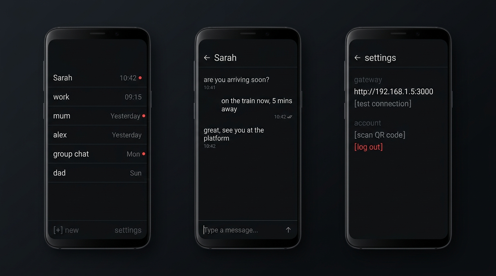

<p align="center">
  
</p>

<h1 align="center">WhatsBB</h1>

<p align="center">
  <b>Minimalist Terminal-Inspired WhatsApp Client for BlackBerry 10</b><br/>
  Native Android APK (API 14+) &bull; Baileys Multi-Device Bridge &bull; Pure Monospace CLI Aesthetic
</p>

<p align="center">
  <a href="https://github.com/warumpas-ops/whatsbb/releases/latest"></a>
  
  
  
  
</p>

---

## Overview

**WhatsBB** is a dedicated WhatsApp client engineered specifically for **BlackBerry 10** devices running the built-in Android Runtime (Passport, Classic, Q10, Q5, Z10, Z30). 

Modern WhatsApp requires Android 5.0+ and Google Play Services, leaving vintage BlackBerry hardware stranded. WhatsBB bridges this gap using a lightweight headless Node.js bridge ([@whiskeysockets/baileys](https://github.com/WhiskeySockets/Baileys)) and a companion native APK designed with a clean, distraction-free **terminal aesthetic**.

<p align="center">
  
</p>

---

## Design Principles

- **Terminal & Monospace Focus**: Every view is set in crisp monospace typography (`#E0E2E6` on `#101113`).
- **No Speech Bubbles**: Messages stream as clean flat text with timestamps (`#555A64`) and delivery checks (`✓✓`).
- **Minimalist Conversation List**: Pure contact names on the left, timestamps on the right, and a solid red dot (`●` `#EF4444`) for unread messages. No noisy previews, no avatar clutter.
- **Hardware Keyboard First**: Tuned specifically for physical BlackBerry QWERTY keyboards with instant shortcuts.
- **Ultra-Lightweight**: Under 250 KB APK footprint, zero WebViews, zero Google Play Services dependency, almost zero battery draw.

---

## Supported BlackBerry 10 Devices

| Device | Screen Resolution | Keyboard | Status |
| :--- | :--- | :--- | :--- |
| **BlackBerry Passport** | 1440 &times; 1440 (1:1) | 3-row Physical QWERTY | Fully Supported |
| **BlackBerry Classic** | 720 &times; 720 (1:1) | 4-row Physical QWERTY + Trackpad | Fully Supported |
| **BlackBerry Q10** | 720 &times; 720 (1:1) | 4-row Physical QWERTY | Fully Supported |
| **BlackBerry Q5** | 720 &times; 720 (1:1) | 4-row Physical QWERTY | Fully Supported |
| **BlackBerry Z10** | 768 &times; 1280 (15:9) | Virtual Touch Keyboard | Fully Supported |
| **BlackBerry Z30** | 720 &times; 1280 (16:9) | Virtual Touch Keyboard | Fully Supported |

---

## Physical Keyboard Shortcuts

When using a physical QWERTY keyboard (Passport, Classic, Q10, Q5):

| Key | Action |
| :--- | :--- |
| <kbd>Enter</kbd> | Send message immediately |
| <kbd>Shift</kbd> + <kbd>Enter</kbd> | Insert newline in message input |
| <kbd>T</kbd> | Jump to **Top** of conversation list |
| <kbd>B</kbd> | Jump to **Bottom** of conversation list |
| <kbd>N</kbd> | Start **New** conversation / enter phone number |
| <kbd>R</kbd> | **Refresh** chat list from bridge |
| <kbd>S</kbd> | Open **Settings** |

---

## Architecture

```
┌─────────────────────────────────┐           HTTP REST           ┌─────────────────────────────────┐
│       BlackBerry 10 Device      │ ◄───────────────────────────► │          Bridge Server          │
│       WhatsBB Native APK        │        Poll / Send APIs       │        (Node.js + Baileys)      │
│     (Android 4.3 Runtime)       │                               │   Runs on PC / Pi / VPS / LAN   │
└─────────────────────────────────┘                               └────────────────┬────────────────┘
                                                                                   │ WhatsApp Web
                                                                                   │ Multi-Device
                                                                                   │ E2EE Protocol
                                                                                   ▼
                                                                  ┌─────────────────────────────────┐
                                                                  │        WhatsApp Servers         │
                                                                  └─────────────────────────────────┘
```

1. **Bridge Server**: Runs on a local computer, Raspberry Pi, home server, or cloud VPS. Connects to WhatsApp via official multi-device web pairing (E2EE).
2. **WhatsBB App**: Native Android app installed on BlackBerry 10. Communicates with your bridge server over standard HTTP JSON endpoints.

---

## Setup & Installation

### Step 1: Start the Bridge Server

Requirements: [Node.js](https://nodejs.org/) v18+ installed on your PC or home server.

```bash
# Clone the repository
git clone https://github.com/warumpas-ops/whatsbb.git
cd whatsbb/server

# Install dependencies
npm install

# Start the bridge
node server.js
```

The bridge server will output:
```
[WhatsBB] Bridge server listening on port 3000
[WhatsBB] Open http://<YOUR_IP>:3000 in your browser to link WhatsApp
```

1. Open `http://localhost:3000` (or `http://YOUR_SERVER_IP:3000`) in your web browser.
2. Open WhatsApp on your primary phone &rarr; **Settings** &rarr; **Linked Devices** &rarr; **Link a Device**.
3. Scan the QR code displayed on the bridge web page.
4. Once paired, the terminal will confirm `status: CONNECTED`.

> [!TIP]
> If you run the bridge on your PC, make sure both your PC and your BlackBerry 10 device are connected to the same Wi-Fi network. Note down your PC's local IP address (e.g. `192.168.1.5`).

---

### Step 2: Install WhatsBB on BlackBerry 10

1. Download the latest `WhatsBB.apk` from [GitHub Releases](https://github.com/warumpas-ops/whatsbb/releases/latest).
2. Sideload the APK onto your BlackBerry 10 device using your preferred method:
   - Direct download using the BlackBerry 10 native browser.
   - Sachesi, DBB Commander, or BB10 File Manager.
   - Transfer over USB storage or Bluetooth.
3. Open **WhatsBB** from your device launcher.

---

### Step 3: Connect the App to Your Bridge

1. In the app, tap `settings` at the bottom right (or press <kbd>S</kbd>).
2. Under `gateway`, enter your bridge server address (e.g. `http://192.168.1.5:3000`).
3. Tap `[save]`, then `[test connection]`.
4. Return to the home screen &mdash; your conversations will sync automatically.

---

## API Endpoints (Bridge Server)

The bridge provides clean, low-overhead REST endpoints:

- `GET /api/status` &mdash; Connection state (`CONNECTED`, `CONNECTING`, `SCAN_QR`, `DISCONNECTED`).
- `GET /api/chats` &mdash; List of chats with JID, name, unread count, and last message.
- `GET /api/messages?jid=<jid>` &mdash; Message thread history for a chat.
- `POST /api/send` &mdash; Send a text message (`{ "jid": "...", "text": "..." }`).
- `POST /api/messages/fetch-history` &mdash; Fetch older messages on demand.
- `GET /api/contacts` &mdash; Contact address book for starting new chats.
- `POST /api/logout` &mdash; Disconnect session and unlink device.

---

## Privacy & Security

- **Direct Connection**: All communication between the app and the bridge server happens directly over your local network or your own private host.
- **No Third-Party Analytics**: No trackers, no telemetry, no remote SDKs.
- **Credentials Protected**: Session credentials remain isolated on your own bridge server (`server/auth_info/`) and are never committed or shared.

---

## License

This project is licensed under the [MIT License](LICENSE).
WhatsApp is a registered trademark of Meta Platforms, Inc. This project is an independent open-source client and is not affiliated with or endorsed by Meta.
